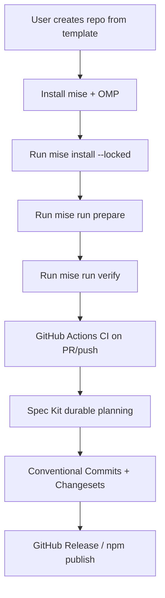

# Rill Template

**GitHub repository template for agents building TypeScript projects with Spec Kit and OMP.**

<picture>
  <source
    media="(prefers-color-scheme: dark)"
    src=".github/assets/logo-dark.svg"
  >
  <source
    media="(prefers-color-scheme: light)"
    src=".github/assets/logo-light.svg"
  >
  
</picture>

## Start a project

1. Create a repository from this template and clone it.
2. Install [mise](https://mise.jdx.dev/) and [OMP](https://github.com/can1357/oh-my-pi). Review and trust the mise configuration, then run `mise install --locked`.
3. Run `mise run prepare` and `mise run verify`. GitHub Actions runs the fast gate on pull requests and pushes to `main`.
4. Use `/speckit.specify`, `/speckit.plan`, `/speckit.tasks`, and `/speckit.implement` for features that need durable planning. Run `specify workflow info assess` for the idea assessment workflow. Small, clear changes can use direct delivery.

## Submit a change

Use `Delivery: <verification summary>` for direct delivery, `Spec: specs/<feature-directory>` for a Spec Kit record, or `Maintenance: <reason>` for routine maintenance. Include observed results and operational or rollback details when applicable. The PR workflow validates the declaration and, when selected, checks for the Spec Kit artifacts.

For independent enforcement, use a contributor identity without administration or bypass permissions, and keep the owner's credentials outside agent sessions. Configure GitHub to require owner review, dismiss stale approvals, and require checks from a trusted source controlled outside the candidate branch. Each repository created from the template needs its own enforcement configuration.

An optional Rill workflow plugin can recognize this template through `.omp/rill-workflow`. The project installs its tools, runs its Spec Kit workflow, and verifies changes using the commands above independently of the plugin.

## Architecture

## Document metadata

Add YAML front matter to Rill-authored Markdown. Use a unique, stable `id`, a `title`, a lifecycle `status`, `superseded_by` (null or a replacement ID), an ISO `last_updated` date, and `related_code` paths relative to the repository root. Run `mise run docs:check` to validate the records against the executable schema. Upstream skill and Spec Kit assets, Changesets entries, and generated root or workspace package changelogs keep their native formats. Under `specs/<feature-directory>`, Spec Kit's specs, plans, tasks, research, data models, quickstarts, checklists, and contracts can use their native format. The assessment outputs also support native Markdown. The gate accepts the upstream description-only task header and validates Rill metadata against the six-field schema.

## Add a package

Scaffold a package under `packages/` with maintained tools. Declare the package module type in `package.json`. Give it `build`, `typecheck` and `test` scripts. Use `tsrs --noEmit -p tsconfig.json` for type checking with a package-local configuration extending the root `tsconfig.json`. Refresh the Bun lockfile with `bun install` when workspace manifests change. Run `mise run verify` before committing.

For packages tested with `bun:test`, keep `@types/bun` in the package's `devDependencies` and set `"types": ["bun"]` in its `tsconfig.json` under `compilerOptions`. This loads Bun's type declarations during the package's type check.

- Use `tsdown` for `build`. Declare the TypeScript entry and declaration output in the package's tsdown configuration and point `exports` to the emitted artifacts. Declare `tsdown` in the package's `devDependencies`.
- For applications that read environment variables, declare `@t3-oss/env-core` and `zod` in the application package. Define the schema with `createEnv`, pass `process.env` as `runtimeEnv`, and validate before invoking application logic. Pass typed values to the core and keep environment reads at the entry point.
- Declare `fast-check` in the package's `devDependencies` when testing invariants. Run `fc.assert(fc.property(...))` in the ordinary Bun tests and preserve the seed and path when investigating a failure.
- For releasable packages, declare `@stryker-mutator/core` as a package dev dependency and add `"mutation": "stryker run"`. Configure the supported `command` test runner with `commandRunner.command` set to `bun run test`, target the core source via `mutate`, and set `thresholds.break` to the agreed minimum. Verify that the test command reads the mutated sources.

The repository-wide rules live in [the constitution](.specify/memory/constitution.md).

## Review, version, and release

- Run `mise run hooks` once after cloning. Use atomic Conventional Commits and a Conventional Commit PR title. In GitHub, enable squash merging, use the PR title as the squash commit title, and require the `verify` check on `main`.
- For a package change with a release impact, run `mise run changeset`, select the package and SemVer bump, and commit the generated record with the change. Record acceptance evidence in the corresponding Spec Kit feature. Dependabot opens dependency updates for review through the same CI.
- To enable automated version PRs, install a repository-scoped GitHub App with Contents and Pull requests write permissions. Set `VERSION_APP_ID` to its client ID and `VERSION_APP_PRIVATE_KEY` to its private key secret. Its installation token lets the version PR trigger normal CI. Without the app, an authorized maintainer can run `mise run version` on a dedicated branch and open the version PR. Review the generated versions, changelogs, and lockfile before merging.
- For template releases, configure the `github-release` environment with owner approval and allow only `main`, then set `TEMPLATE_RELEASE_ENABLED=true`. Dispatch **Release template** from `main` with an unused `vX.Y.Z` tag. The job verifies the source and publishes release notes for the selected commit.
- To enable npm releases, configure the `npm-publish` environment with owner approval and allow only `main`. Configure npm Trusted Publishing for each public package with workflow `publish.yml` and environment `npm-publish`, then set `NPM_PUBLISH_ENABLED=true`. If npm requires an initial publication to create the package, complete that publication with owner authorization before enabling CI publishing. Dispatch **Publish npm package** from the verified version commit on `main` with the exact workspace package name. Keep nonpublishable packages marked `private`.
- Revert source changes through a reviewed PR. If a broken package version is already public, release a corrected version with a new changeset and deprecate the broken version when appropriate. Preserve existing tags and release history.

## Local quality checks

- Run `mise install --locked` and `mise run prepare` when bootstrapping or changing the toolchain. Preparation installs frozen dependencies and warms the formatter plugin cache.
- Run `mise run fmt` to format repository-owned files. Oxfmt owns JavaScript and TypeScript. dprint owns Markdown, JSON, YAML, and TOML. Installed Spec Kit assets and generated locks retain their upstream format.
- Run `mise run verify` for the full local gate after preparation. It checks formatting, lint, types, tests, dependency boundaries, declared API reports, secrets, and workflow configuration. The default remote gate is `mise run verify:fast`. Dispatch **Verify** manually to run the full gate independently in GitHub Actions.
- The full gate also runs Knip for unused files, exports and types, and ast-grep for repository rules. Run `mise run qualify` before release to run the full gate and each package's configured mutation tests.
- Run `mise run deps` with network access for a fresh vulnerability scan and dependency update listing.
- For a package with a public TypeScript API, run `bunx --no-install api-extractor init` from the package directory. Configure `mainEntryPointFilePath` to the emitted declaration entry, enable `apiReport`, and commit the generated report. Add `api:check` with `api-extractor run` to the package scripts. Generate intentional baseline changes with `api-extractor run --local` and review the report alongside the implementation.
